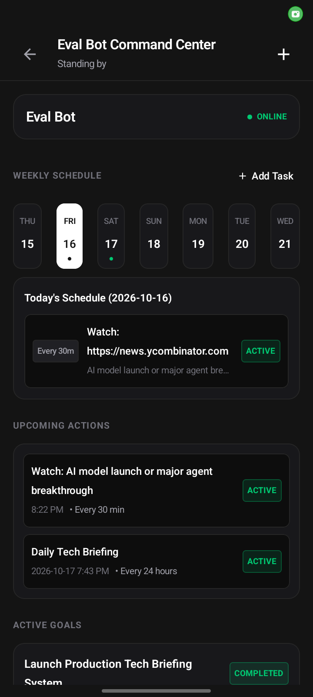
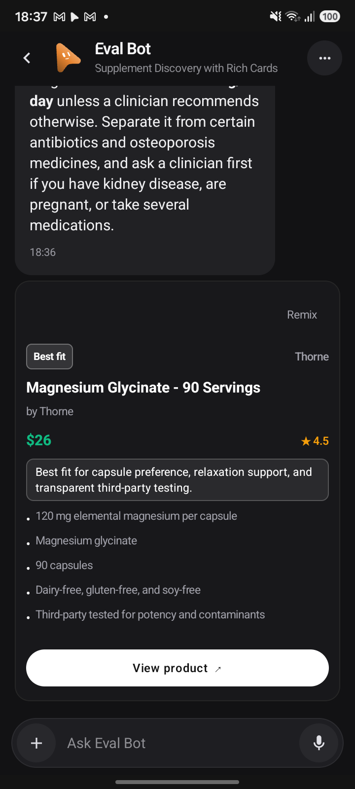
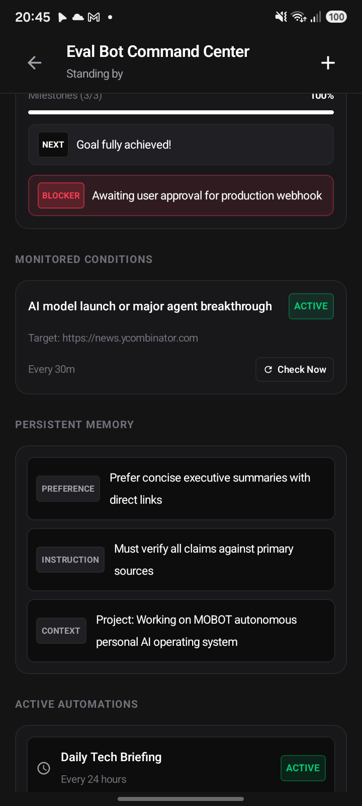

<div align="center">

# MOBOT

**The Autonomous Personal AI Operating System for Android**

<sub>A local-first, agentic mobile operating system that transforms AI into proactive personal companions with hands, persistent memory, and autonomous capability orchestration.</sub>

<br>


<br>

<p align="center">
  &nbsp;&nbsp;
  &nbsp;&nbsp;
  
</p>

</div>

---

## Overview

**MOBOT** turns your Android phone into an autonomous personal AI operating system. 

Rather than treating AI as a passive text box, MOBOT organizes your intelligence into a roster of persistent, autonomous agents—each with its own dedicated role, isolated memory workspace, scheduled routines, and ability to proactively monitor the world and orchestrate real device and web tools.

Styled after the high-contrast, minimalist **Grok** aesthetic with deep OLED blacks, crisp 1px hairlines, and restrained typography, MOBOT delivers an operating system experience designed for focus, autonomy, and speed.

---

## Core Capabilities

<table>
<tr>
<td width="50%" valign="top">

### 🗓️ Bot Command Center
Every bot features a dynamic **Command Center** reflecting its live state:
* **7-Day Weekly Schedule**: Visual calendar strip with real scheduled routines, tasks, and recurring briefings.
* **Upcoming Actions**: Chronological ledger of queued background jobs and intervals.
* **Persistent Memory**: Categorized memory cards (`Preference`, `Instruction`, `Context`, `Fact`) backed by durable Markdown.
* **Automations**: Live controls to inspect, run, pause, or resume scheduled bot routines.

<p align="center">
  
</p>

</td>
<td width="50%" valign="top">

### 🎯 Autonomous Goals & Watches
Bots autonomously execute long-term multi-step objectives:
* **Goal Engine**: Tracks milestones, percentage completion, and updates human-readable `NEXT` step callouts.
* **Blocker Detection**: Surfacing dependencies and roadblocks into clean `BLOCKER` badges.
* **World Awareness Watches**: Continuous background monitoring of URLs, APIs, or conditions with customizable cadence and single-tap **Check Now** verification.

<p align="center">
  
</p>

</td>
</tr>
<tr>
<td width="50%" valign="top">

### 🔘 Autonomous Capability Selection & MCQs
When clarification or requirement gathering is beneficial:
* **Autonomous Invocation**: The agent independently decides when a structured question card is superior to plain text.
* **Interactive Option Chips**: Single-select and multi-select radio chips with instant validation.
* **Zero Guesswork**: The user never has to request a form—MOBOT generates interactive choices automatically.

<p align="center">
  
</p>

</td>
<td width="50%" valign="top">

### 🛍️ Rich Product Discovery Cards
For product recommendations, discovery, and search:
* **Verified Destination Links**: Native actionable cards linking directly to the authentic product source.
* **Structured Product Cards**: High-resolution image, title, price, retailer, star ratings, and tailored rationale.
* **Zero Fabrication**: Verified specs and pricing without hallucinated links or data leakage.

<p align="center">
  
</p>

</td>
</tr>
</table>

---

## System Architecture

MOBOT operates on an isolated, local-first engine hosted directly inside the Android application:

```
┌────────────────────────────────────────────────────────┐
│                   Android Native App                   │
│          (Jetpack Compose · OLED Design Tokens)        │
└───────────────▲────────────────────────▲───────────────┘
                │                        │
       WebSocket & REST (Localhost)      │ Direct Native Binder
                │                        │
┌───────────────▼────────────────────────▼───────────────┐
│               Embedded Local Host Engine               │
│               (Node.js Runtime on Android)             │
├────────────────────────────────────────────────────────┤
│  • Capability Registry & Orchestrator                  │
│  • Multi-Step Goal Engine (server/goals.ts)           │
│  • World Awareness Watches (server/watches.ts)         │
│  • Specialist Swarm Coordinator                        │
│  • Location Context Engine (server/location-context.ts)│
│  • Durable SQLite Storage & Markdown Workspaces        │
└────────────────────────────────────────────────────────┘
```

### Key Engineering Principles
1. **Zero Emojis & AI Slop**: The UI enforces an editorial, Grok-standard design language. All notification badges, status pills, and blocker cards use crisp typography and minimal micro-badges (`NEXT`, `BLOCKER`, `ONLINE`).
2. **Persistent User Location Context**: Privacy-preserving geographic context with explicit provenance tracking (`device`, `user_set`, `timezone_inferred`). Location precision is strictly respected (a timezone never fabricates a city), and explicit user overrides or `"don't use my location"` requests are deterministically enforced.
3. **Isolated Workspaces**: Each bot maintains its own independent workspace on the device filesystem with strict sandboxing and atomic state persistence.

---

## Building & Installation

### Prerequisites
* **Android Studio Ladybug** or newer
* **Android SDK 34+**
* **Node.js 22+** and **pnpm**
* Connected physical device (e.g. Samsung Galaxy, Google Pixel) with Developer Options enabled

### Quick Start

1. **Clone the repository:**
   ```bash
   git clone https://github.com/abhayShyam004/MOBOT.git
   cd MOBOT
   ```

2. **Install host dependencies and build server bundle:**
   ```bash
   pnpm install
   pnpm build:server
   ```

3. **Package host assets into Android project:**
   ```bash
   node scripts/prepare-android-host.mjs
   ```

4. **Assemble and install the debug APK:**
   ```bash
   cd android
   ./gradlew :app:assembleDebug
   adb install -r -d app/build/outputs/apk/debug/app-arm64-v8a-debug.apk
   ```

5. **Launch MOBOT:**
   ```bash
   adb shell am start -n com.openmausbot.companion/.MainActivity
   ```

---

## Test Suites & Verification

MOBOT includes comprehensive automated unit, integration, and on-device test suites:

* **Location Context & Privacy**: `npx vitest run server/location-context.test.ts` (11 passing tests)
* **Command Center & Overview**: `npx vitest run server/bot-overview-command-center.test.ts`
* **Goals Engine**: `npx vitest run server/goals.test.ts`
* **Watches & World Awareness**: `npx vitest run server/watches.test.ts`
* **Specialist Swarm**: `npx vitest run server/specialist-swarm.test.ts`
* **Structured Extraction**: `npx vitest run server/structured-extract.test.ts`

Run all test suites:
```bash
pnpm test
pnpm typecheck
pnpm lint
```

---

## License

Distributed under the MIT License. See [LICENSE](LICENSE) for more information.
