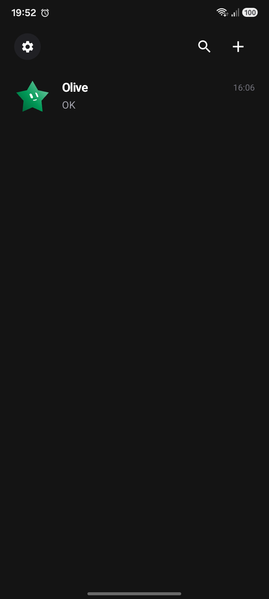
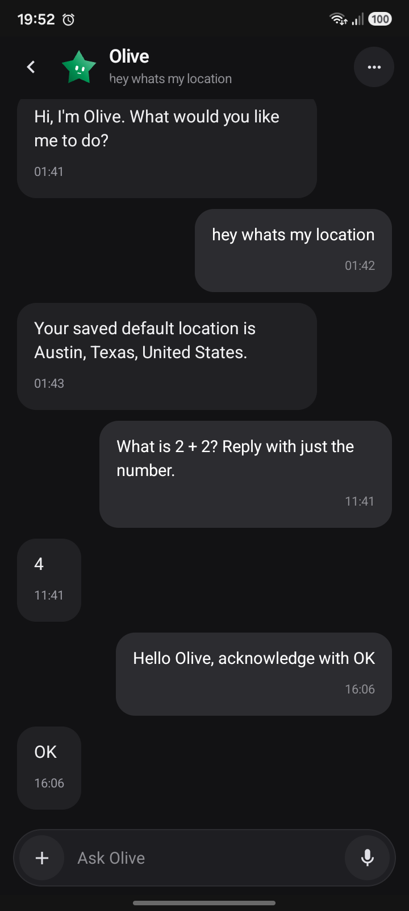
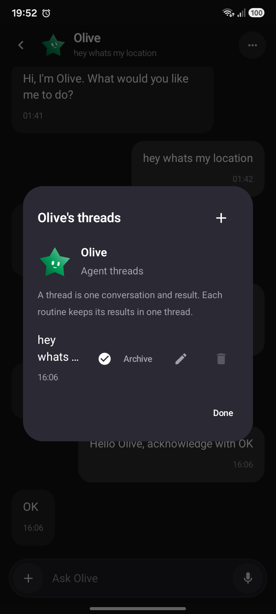
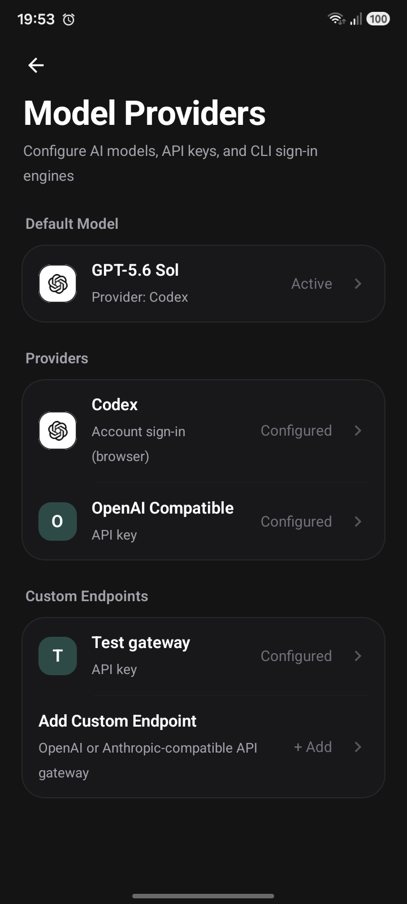
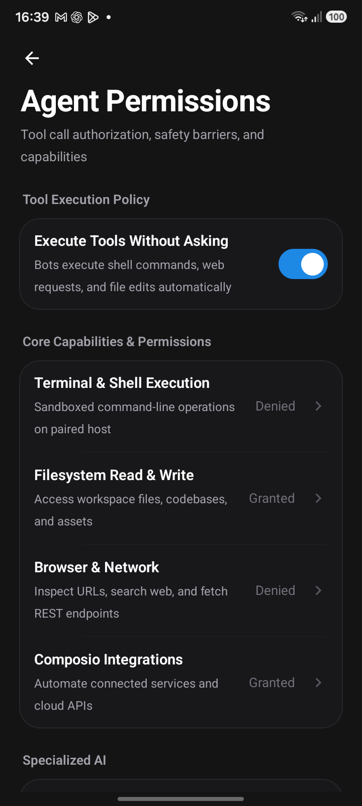
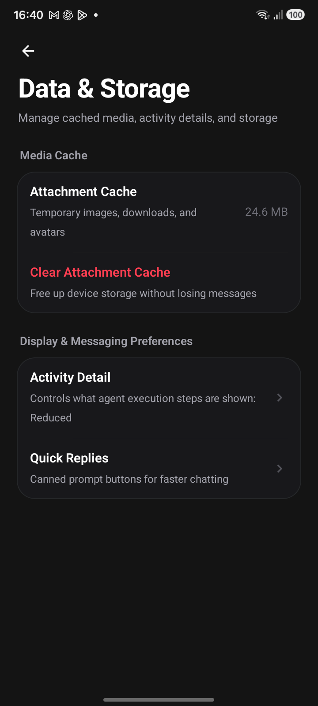
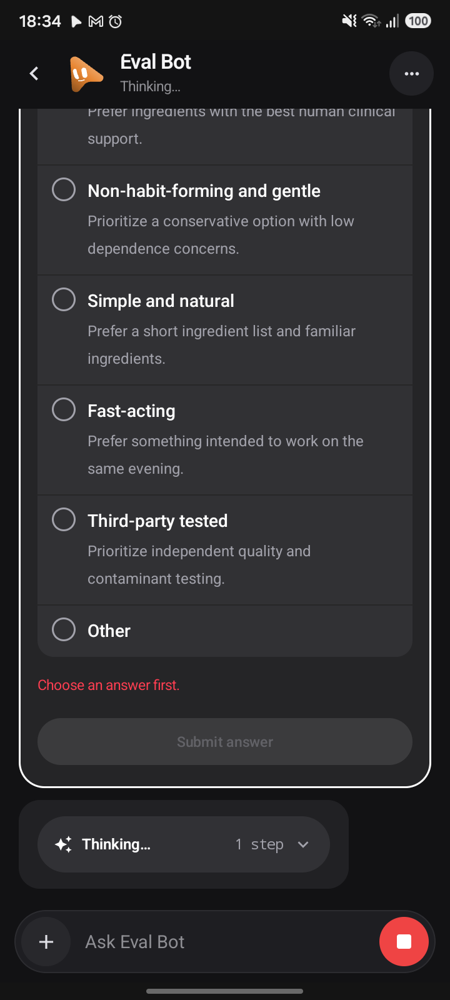
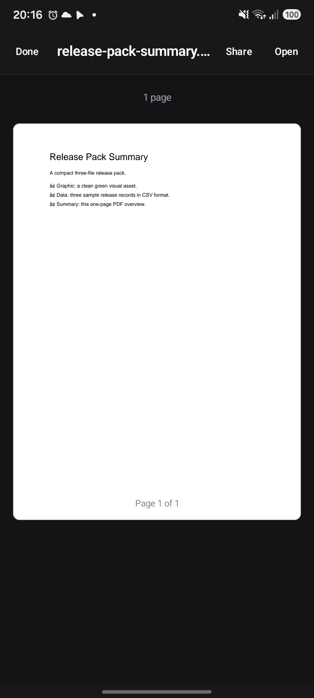

# MOBOT

The Autonomous Personal AI Operating System for Android

A local-first, agentic mobile operating system combining autonomous conversational agents, persistent local memory workspaces, authoritative permission boundaries, connected third-party integrations, and native Android computer use.


---

## What MOBOT Does

MOBOT transforms an Android device into an autonomous personal AI runtime. Rather than operating as a passive chat interface, MOBOT hosts a roster of persistent agents. Each agent maintains its own role, isolated disk workspace, durable memory, and capability profile.

Agents run directly on-device or against configured model providers. When given goals, agents coordinate specialized subagents, query connected services, interact with the physical device through Android Computer Use, and respect strict user-configured execution policies.

---

## Core Capabilities

- Persistent Agent Roster: Dedicated bots with distinct personas, isolated workspaces, and durable memory files.
- Authoritative Execution Policies: Real runtime boundaries controlling Terminal execution, Filesystem access, Browser and network requests, and Composio integrations.
- Connected Services: Native OAuth flows and API integrations via Composio, supporting Google, GitHub, Notion, Linear, Slack, and dozens of third-party platforms with live status detection.
- Android Computer Use: Direct phone control via accessibility hierarchy inspection, foreground activity verification, semantic control tapping, text input, scrolling, and application management.
- Multi-Provider Catalog: First-class support for OpenAI, Anthropic Claude, Google Gemini, xAI Grok, Codex, and custom OpenAI-compatible endpoints with local model discovery.
- Structured Interactive Cards: Autonomous selection chips (single-select and multi-select MCQs), product discovery cards, and job research surfaces embedded directly in chat.
- Native Document Pipeline: Embedded rendering for PDFs, Markdown documents, structured JSON, and image artifacts.

---

## Product Screenshots

### Core Interface and Roster

| Agent Roster | Conversational Chat | Bot Overview |
| :---: | :---: | :---: |
|  |  |  |

### Model Providers and Governance

| Model Providers | Agent Permissions | Connected Services |
| :---: | :---: | :---: |
|  |  |  |

### Structured Reasoning and Artifacts

| Interactive Selection | Product Research | Native PDF Viewer |
| :---: | :---: | :---: |
|  |  |  |

### Android Computer Use

| Device Control |
| :---: |
|  |

---

## Architecture

MOBOT runs a local host runtime coupled to an Android client with strict process boundaries:

```
+-------------------------------------------------------------------+
|                        Android Native Client                      |
|                  Jetpack Compose / OLED Dark UI                   |
+---------------------------------+---------------------------------+
                                  |
                   IPC / Local HTTP & WebSockets
                                  |
+---------------------------------v---------------------------------+
|                      Local MOBOT Host Engine                      |
|               Embedded Node.js Runtime + SQLite                   |
+-------------------------------------------------------------------+
|  - Capability Registry & Dispatch Broker                          |
|  - Agent Roster & Context Manager                                 |
|  - Autonomous Multi-Step Reasoning Engine                         |
|  - Structured Artifact & Memory Store                             |
+---------------------------------+---------------------------------+
                                  |
+---------------------------------v---------------------------------+
|                  Authoritative Permission Policy                  |
|     (Terminal & Shell | Filesystem | Browser | Composio)          |
+-------+-----------------+-----------------+-----------------+-----+
        |                 |                 |                 |
        v                 v                 v                 v
  +-----------+     +------------+    +-----------+    +------------+
  |  Terminal |     | Filesystem |    |  Browser  |    |  Composio  |
  |  Subsystem|     |  Workspace |    | Automation|    | Connected  |
  +-----+-----+     +------------+    +-----------+    |  Services  |
        |                                              +------------+
        v
+-------------------------------------------------------------------+
|                    Android Computer Use Engine                    |
|  - UI Automation & Accessibility Hierarchy Node Extraction        |
|  - Foreground Activity Settling & Verification                    |
|  - Semantic Node Targeting (Text / Description / Bounds)          |
|  - Text Input Verification & Field Clearing                       |
|  - Gesture & Navigation Dispatch (Swipe / Back / App Switch)      |
+---------------------------------+---------------------------------+
                                  |
                                  v
+-------------------------------------------------------------------+
|                  Physical Android Operating System                |
|                    (Android 14+ / One UI / AOSP)                  |
+-------------------------------------------------------------------+
```

---

## Security and Permissions

MOBOT enforces an authoritative execution boundary. Tools cannot execute unless permitted by both the persisted user configuration and runtime capability gates:

1. Terminal and Shell Execution: Controls execution of shell scripts, system binaries, CLI tools, subprocesses, and device-level ADB commands. Revoking this permission immediately blocks device actions and shell executions before dispatch.
2. Filesystem Read and Write: Governs read, write, modification, and deletion of workspace files, projects, and local artifacts.
3. Browser and Network: Restricts outbound HTTP requests, web search, web page extraction, and browser automation sessions.
4. Composio Integrations: Manages tool execution against third-party OAuth connections. Revoking permission disables agent invocation without deleting or disconnecting user accounts.

Permission changes synchronize atomically across disk, memory, and UI state.

---

## Connected Services

MOBOT integrates with Composio to provide access to hundreds of cloud tools and productivity services:

- Direct Authentication: In-app authorization flows with deep linking and browser verification.
- Authoritative Status: Live detection of active, disconnected, expired, or unconfigured accounts.
- Multi-Account Support: Connect multiple distinct accounts per service with active profile selection.
- Safe Disconnection: Clean separation between credential revocation and execution permissions.

Supported integrations include Google Workspace (Gmail, Calendar, Drive), GitHub, Linear, Notion, Slack, Jira, and custom REST tools.

---

## Android Computer Use

MOBOT features a hardened, physical Android automation substrate:

- Application Discovery: Authoritative package resolution distinguishing between installed, launchable, and enabled packages, mapped to human-friendly application labels.
- Foreground Verification: Application launches wait for the device window focus to settle and verify that the target package is active before reporting completion.
- Screen Observation: Fast accessibility hierarchy dumps extracting semantic nodes with text, accessibility descriptions, resource IDs, clickable tags, editable flags, and pixel coordinates.
- Interaction Primitives: Tap by text label, tap by coordinate center, type ASCII text with input verification, clear focused field, directional swipe with screen-size adaptation, and navigation keyevents (Back, Home, App Switch).
- Structured Failure Model: Action errors are explicitly classified into discrete failure categories:
  - `APP_NOT_INSTALLED`
  - `APP_NOT_LAUNCHABLE`
  - `ANDROID_ACCESS_REQUIRED`
  - `TARGET_NOT_FOUND`
  - `ACTION_NOT_SUPPORTED`
  - `ACTION_FAILED`
  - `TIMEOUT`
  - `VERIFICATION_FAILED`
  - `PERMISSION_DENIED`
- Turn Isolation and Mutex: Every device action is tracked with turn and action identifiers to prevent stale actions, duplicate executions, or cross-turn race conditions.

---

## Building

### Prerequisites

- Android Studio Ladybug (2024.2.1) or newer
- Android SDK Platform 34 or 35
- Node.js 22 LTS or newer
- pnpm 9 or newer
- Connected physical Android device or authorized emulator with Developer Options and USB Debugging enabled

### Build Steps

1. Clone the repository:
   ```bash
   git clone https://github.com/abhayShyam004/MOBOT.git
   cd MOBOT
   ```

2. Install dependencies:
   ```bash
   pnpm install
   ```

3. Prepare the Android embedded host assets:
   ```bash
   node scripts/prepare-android-host.mjs
   ```

4. Assemble the Android debug APK:
   ```bash
   cd android
   ./gradlew :app:assembleDebug
   ```

5. Install to connected device:
   ```bash
   adb install -r -d app/build/outputs/apk/debug/app-arm64-v8a-debug.apk
   ```

6. Launch MOBOT:
   ```bash
   adb shell am start -n com.openmausbot.companion/.MainActivity
   ```

---

## Testing

MOBOT includes comprehensive automated unit, integration, and on-device acceptance test suites.

### Running Test Suites

- Phone Proxy and App Discovery:
  ```bash
  npx vitest run server/drivers/phone-proxy.test.ts
  ```

- Permission Policy and Execution Boundaries:
  ```bash
  npx vitest run server/permission-policy.test.ts
  ```

- Composio and Connected Services:
  ```bash
  npx vitest run server/composio.test.ts server/connector-proxy.test.ts
  ```

- Provider Catalog and Model Discovery:
  ```bash
  npx vitest run server/drivers/openai-compatible-catalog.test.ts
  ```

- TypeScript Validation:
  ```bash
  pnpm typecheck
  ```

- Physical Samsung Hardware Acceptance:
  ```bash
  node --experimental-strip-types scripts/verify-phone-acceptance.ts
  ```

---

## Project Status

MOBOT is under active development. Core architectural components including the local host engine, permission policy, model provider catalog, connected services, and Android computer use are functional and physically verified on Samsung Galaxy hardware.

---

## License

Distributed under the MIT License. See [LICENSE](LICENSE) for more information.
