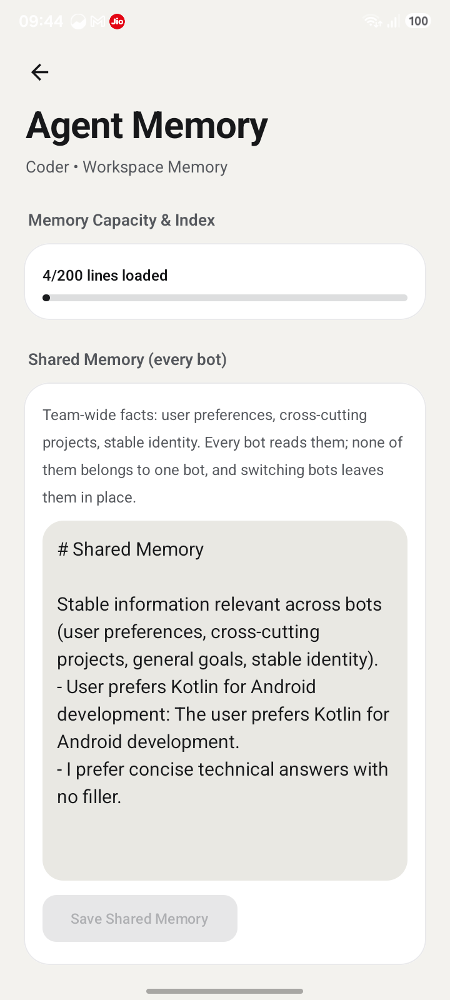
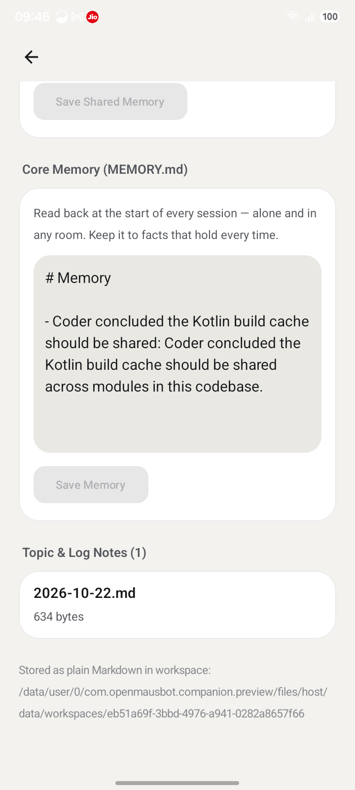

# Canonical memory integrity, provenance authentication and anti-tampering — acceptance report

Phase 7 security-hardening follow-up to the Phase 6 shared-Memory poisoning fix.
Everything below is measured on the final working tree (`HEAD b945d727`, dirty,
no commits) and the final packaged Android preview bundle.

---

## 1. Final acceptance status

**ACCEPTED for the supported threat model** (defined in §2): a process that can
read and write the memory data directory — a bot's own file tools, the phone
file surface, a sync/backup tool, `adb run-as`, another app instance, an editor —
but cannot read the integrity key. Every forgery, edit, deletion, reorder,
substitution and corrupt-byte case in §11 is refused before a record reaches
model context, and the refusal is audited without copying the forged text.

**Not claimed:** protection against a process that runs as the app's own uid and
can therefore read `memory-integrity/key` or replace the running server. That is
stated as residual risk in §17, with the concrete device measurement in §12.7.
It is not a hidden limitation: the same privilege can rewrite the runtime, so no
in-process control can outlive it.

| Question | Result |
|---|---|
| Can a directly edited record become context? | **NO** — PASS (unit, e2e, device) |
| Can a forged/deleted/reordered/duplicated record become context? | **NO** — PASS |
| Can a record's owner, scope, category, confidence, provenance or lifecycle be changed? | **NO** — PASS (§11 A.1–A.10) |
| Can the manifest be edited, removed, or rolled back? | Edited/removed **NO**; paired rollback of records+manifest **undetectable** (§8) |
| Does legitimate shared memory still work across bots? | **YES** — PASS (unit + device) |
| Does specialized memory stay private? | **YES** — PASS (unit + device) |
| Phase 4/5/6 semantics intact? | **YES** — 204 + 107 + 101 + 18 + 10 tests PASS |
| Does a failed check leak forged content or crash? | **NO** — PASS (`ERR_MEMORY_INTEGRITY`, audited) |
| Is the packaged device server the tested source? | **YES** — hash chain in §14 |

---

## 2. Threat model and trust boundaries

**Trusted:** the server process, the canonical memory store (`server/memory-store.ts`),
the integrity module (`server/memory-integrity.ts`), the key file, the
authenticated Android save route, and the person operating the UI.

**Untrusted input:** every byte of `workspaces/**/memory/records.json`,
`records.integrity.json`, `MEMORY.md`, the memory journal, workspace backups, and
any other file a writer can reach. Presence in any of these files is **not**
evidence of approval.

**Supported attacker (what this phase defends):**

1. A bot's ordinary file tools writing inside its own or the shared workspace.
2. The device file capability (`DeviceFileManager`) reading/writing app files.
3. A process editing, truncating, replacing, reordering, or deleting memory files
   without knowing the integrity key (backup tooling, `adb run-as` copy, a sync
   client, the person's editor).
4. A record planted after the manifest was deleted, or after the whole memory
   directory was removed.
5. A crash between the records write and the manifest write.

**Explicitly outside the supported model (see §17):** a process with the app uid
that reads `memory-integrity/key`, or that replaces the running bundle/JS. Both
are equivalent to owning the runtime.

Trust boundary that matters: `records.json` lives *inside* the bot's workspace,
which is exactly where bot tools can write. The key lives in `DATA_DIR`, outside
every workspace, and is never placed in a record, a manifest, a journal, or an
environment variable handed to an agent subprocess.

---

## 3. Existing architecture and codebase findings

- Canonical store: `server/memory-store.ts` (3010 lines). Records are an array of
  `StoredMemoryRecord` in `<workspace>/memory/records.json`, written atomically
  `0600` via `writeFileAtomic` (`server/atomic.ts`), with a per-record
  `sha256Hash` computed by `computeMemoryRecordHash`.
- Read path: `loadMemoryRecords` → `validateMemoryRecord` → `verifyMemoryRecordHash`
  → lifecycle filter. Context paths: `assembleMemoryForContext`,
  `queryPartitionedMemory`, `retrieveMemoryRecords`.
- Write path: `createMemoryRecord` (redaction → hash) → `saveMemoryRecords`
  (stale-hash 409, 3-way merge, compaction, atomic write) → `journalMemoryWrite`.
- Journal: `server/memory-journal.ts`, per-bot NDJSON, including the Phase 6
  security audit and this phase's `integrity_failure` rows.
- Context injection: `server/capabilities/context-pipeline.ts`,
  `server/system-prompt.ts`, `server/index.ts` (partitioned query route at
  `server/index.ts:16879`).
- Shared/private partition: Phase 6 — `shared/MEMORY.md` is not a trust source;
  `writeMemoryDoc("shared", …, {requestingBotId})` refuses bot writes.
- Phone file surface: `server/capabilities/device-files.ts` (`DeviceFileManager`).
- Migration: `migrateSharedMarkdownOnce` + `ingestSharedMarkdown` in the store;
  the person's save route (`PUT /api/memory/shared`) ingests through the same gate.

**Root cause of the gap:** the only integrity value on a record was
`sha256Hash`, stored in the same file as the record. Any writer that edits a
field can recompute it; `verifyMemoryRecordHash` therefore proved internal
consistency, not authorship. Nothing outside the writable directory vouched for
the store, so a rewritten `records.json` was indistinguishable from canonical
state and flowed into `assembleMemoryForContext`.

---

## 4. Integrity design selected and rationale

Smallest design that creates an authority outside the writable area, reusing
existing primitives (no new database, no second writer, no custom protocol):

1. **HMAC-SHA256 key**, 32 random bytes, created once at
   `<DATA_DIR>/memory-integrity/key`, mode `0600` in a `0700` directory;
   `server/memory-integrity.ts:memoryIntegrityKey()`. Created with `wx` so a
   concurrent creator wins and is read instead of overwritten; an unreadable or
   malformed key is an error, **never** regenerated (regeneration would silently
   bless every record).
2. **Per-record MAC** over an explicit canonical payload
   (`canonicalIntegrityRecord`) naming every field that changes authorization or
   model behaviour: `id`, `botId`, `category`, `headline`, `detail`, `confidence`
   (4 dp), `sourceTurnId`, `createdAt`, `lastReinforcedAt`, `accessCount`,
   `redacted`, `lifecycle`, `archivedAt`, `deletedAt`, `deprecatedAt`,
   `deprecationReason`, `sha256Hash`. Field order is fixed by construction,
   `undefined`/`null` normalise to one value, numbers are truncated/fixed —
   no `JSON.stringify(record)` ambiguity, and unknown future fields cannot change
   whether an old record verifies.
3. **Signed manifest** `memory/records.integrity.json`: `version`, `seq`, `count`,
   `digest` (SHA-256 over the canonical record array *in file order*), `macs`
   (id → MAC), and `mac` (HMAC over the header and every MAC, sorted). It binds
   the whole set, so count changes, deletion, reordering, duplication and
   record substitution all fail, and the manifest itself cannot be edited.
4. **One verification point** — `verifyMemoryIntegrity` called from
   `loadMemoryRecords`, the single read boundary every context path uses.
   `saveMemoryRecords` re-loads (and therefore verifies) the existing store
   before it may replace it, so a caller that skipped the load cannot have a
   tampered array signed as truth.

Why HMAC rather than a signature or Keystore: the verifier and writer are the
same process, so asymmetric keys add no attacker-relevant property; a signature
would need key management the app does not have. Android Keystore-backed MACs
would be stronger against same-uid code and are discussed in §17 as the next
step — they require a Kotlin↔Node bridge that does not exist today, so claiming
them would be dishonest.

---

## 5. Writer authorization and tool containment

- **No signing capability exists on the tool surface.** There is no IPC route,
  MCP tool, or HTTP endpoint that signs arbitrary text; the MAC is computed only
  inside `sealMemoryIntegrity`, called only by `saveMemoryRecords`. An agent
  cannot ask the system to bless a proposal.
- **Device file surface refuses canonical storage.** `isProtectedMemoryPath`
  (`server/memory-integrity.ts:386`) matches `memory/records.json`,
  `memory/records.integrity.json` and the key path, and `DeviceFileManager`
  applies it on read, write, list, stat and walk, checking the resolved
  `realpath` as well as the literal path (`server/capabilities/device-files.ts:75`,
  `:128`, `:180`, `:221`, `:275`). Listing a memory directory simply omits those
  files instead of erroring.
- **Canonical writer remains the only route.** Records are still created by
  `createMemoryRecord` → redaction → `saveMemoryRecords`; reconciliation,
  lifecycle, compaction and the person's save all go through it.
- **Signed state, not proposals.** The MAC covers the post-redaction,
  post-gate, committed record. Shared Markdown ingestion still passes
  confidence > 0.90, universal-relevance, redaction, provenance and lifecycle
  gates before a record exists to be signed (`ingestSharedMarkdown`).

No prompt instruction is relied on anywhere: the guarantees are in code paths.

---

## 6. Record authenticity and integrity verification

Verification order in `loadMemoryRecords`:

1. Missing `records.json` + present manifest → **fail** (`records.json is missing
   but its integrity manifest still exists`).
2. Missing `records.json` + missing manifest → empty store (documented bot-removal
   flow; see §8 for why this is not a forgery path).
3. Non-JSON / non-array / empty-after-upgrade → **fail** (`ERR_MEMORY_HASH_MISMATCH`
   / `ERR_MEMORY_INTEGRITY`).
4. Per-record schema + `sha256Hash` (Phase 4 behaviour retained).
5. Manifest MAC verifies; `count`, `digest`, per-record MAC, duplicate ids and
   orphan MACs all match. Any mismatch → `integrityFailure`.
6. Lifecycle filtering happens **after** verification, so an archived or deleted
   record cannot dodge the check.

`integrityFailure` writes a `permission_denied`-style audit row with category
`integrity_failure`, `errorCode: ERR_MEMORY_INTEGRITY`, path
`memory/records.json`, and the reason string only — no headline, detail, key, or
digest of protected content — then throws `MemoryStoreError("integrity", 500, …)`.
Partition readers are fail-closed per partition: an unverifiable shared store
contributes zero snippets rather than throwing attacker text into a caller's
string.

---

## 7. Journal and rollback guarantees

- The journal is **not** a trust source. A forged journal row cannot create a
  record (`memory-integrity.test.ts > "keeps a tampered journal from becoming
  memory or changing verification"`).
- The manifest carries `seq`, monotonic per store, for diagnostics and to make a
  stale `records+manifest` pair *look* stale in review. It is **not** a rollback
  anchor: an attacker who can rewrite both files can restore an older valid pair,
  and `memory-integrity.test.ts > "does not re-trust a store when the manifest and
  records are rolled back together"` **records that limitation as a passing
  assertion of the known behaviour**, not as protection.
- What *is* protected: deleting the manifest (or the records) while leaving the
  other, and planting a fresh store after deletion. A one-time upgrade ledger in
  `memory-integrity/legacy/` (outside the workspace, named by bot id + workspace
  fingerprint) makes a later "no manifest" state a failure instead of a second
  welcome mat — `"refuses to re-create a deleted manifest for an upgraded store"`
  and `"does not bless a store planted after the records and manifest were deleted"`.
- Crash between the records write and the manifest write → next load fails closed
  (`"fails closed after a crash between the records and manifest writes"`).
  No automatic re-sign, repair or bless.

---

## 8. Migration and backward compatibility

- A pre-authenticity store (records, no manifest, no ledger) is upgraded **once**:
  `acceptLegacyIntegrity` verifies hashes, seals a manifest at `seq 1`, and writes
  the ledger. Idempotent — a second load finds the manifest and touches nothing.
- A store that was upgraded and then loses its manifest is refused, so upgrade is
  not a reusable door.
- Removing the whole memory directory still reads as empty — this is the Phase 4
  bot-removal semantic that `round4-state-stress.test.ts > "leaves no reconcilable
  state behind when a bot's workspace is removed"` requires. This was a real
  regression found during this phase's regression run; the first implementation
  failed closed on that legitimate deletion. Fixed in `loadMemoryRecords` with the
  comment explaining that *absence cannot be forged*, while planting a file in the
  emptied directory still fails (explicit test added).
- Legacy shared Markdown keeps Phase 6 semantics: gate-passing lines become
  records; refused lines stay in the person's document; secrets redacted;
  `migrateSharedMarkdownOnce` inert once records exist.
- No schema break: records keep the same fields; the manifest is additive and
  versioned (`MEMORY_INTEGRITY_VERSION = 1`). An older build that ignores the
  manifest still reads the same `records.json` (it just has no authenticity).

---

## 9. Phase 4–6 regression results

Commands run from the repository root with `set -o pipefail`; exit codes are the
pipeline's first command.

| Suite | Tests | Result |
|---|---|---|
| `npx vitest run server/memory-store.test.ts server/memory-partition.test.ts server/memory-journal.test.ts server/memory-reconciliation.test.ts server/memory-routes.test.ts` | 204 | **PASS** (exit 0) |
| `npx vitest run server/round4-state-stress.test.ts server/round7-adversarial-reproduction.test.ts server/memory-integrity.test.ts` | 107 | **PASS** (exit 0) |
| `npx vitest run server/capabilities/context-pipeline.test.ts server/permission-policy.test.ts server/capabilities/capability-registry.test.ts` (re-run on the final source) | 54 | **PASS** (exit 0) |
| The same three files plus `memory-reconciliation` and `memory-routes` (earlier run) | 101 | **PASS** (exit 0) |
| `npx vitest run server/index.test.ts -t "bot memory API"` | 18 passed / 213 skipped | **PASS** (exit 0) |
| `npx vitest run server/memory-room-prompt.e2e.test.ts server/thread-aware-bots.e2e.test.ts` | 10 | **PASS** (exit 0) |
| `npx vitest run server/memory-integrity.test.ts` (final, after fix) | 39 | **PASS** (exit 0) |

Phase 4 guarantees preserved and exercised through the new boundary: atomic
`0600` writes, redaction before hashing, stale-hash 409, 3-way merge under
concurrency (`memory-store.test.ts:542`, `:1051`, `:1168`), compaction, lifecycle
archive/delete, journal consistency. Phase 5 reconciliation stays scope-aware and
auditable (`memory-reconciliation.test.ts`, `round4-state-stress.test.ts:410`,
`:492`). Phase 6 shared/private partitioning unchanged.

Earlier reports observed pre-existing full-suite failures present in a pristine
`b945d727` worktree. This phase did not run the whole 885-file suite; the targeted
suites above are the ones this change can affect. Full suite: **NOT RUN** (§17).

---

## 10. Adversarial test matrix and observed results

All cases use `putMemoryRecord`/`putSharedMemoryRecord` to create a genuinely
valid record, then mutate bytes on disk (several also recompute the record's
SHA-256 — the strongest pre-integrity attacker), then read through
`loadMemoryRecords`, `queryPartitionedMemory` and `assembleMemoryForContext`.

### A. Record tampering — `server/memory-integrity.test.ts`

| # | Attack | Result |
|---|---|---|
| 1–10 | change headline, detail, confidence, owner bot id, category, provenance, record id, lifecycle, timestamps, access count (SHA recomputed each time) | **PASS** — all rejected `ERR_MEMORY_INTEGRITY` |
| 11 | append forged record with a valid record SHA | **PASS** — rejected |
| 12 | delete a valid record | **PASS** — rejected |
| 13 | replace file with another store's valid records | **PASS** — rejected |
| 14 | reorder records (all MACs unchanged) | **PASS** — rejected by digest/order |
| 15 | duplicate record ids | **PASS** — rejected |
| 16 | restore an older valid snapshot of both files | **FAIL by design** — undetectable without an out-of-workspace anchor; documented in §7 |
| 17 | replace with a symlink to a tampered copy | **PASS** — rejected |
| 18 | truncate / `{}` / non-JSON / empty file | **PASS** — rejected |
| 19 | record changed during a concurrent update | **PASS** — save re-loads and verifies under the existing lock; stale/concurrent suite green (`memory-store.test.ts:542/1051/1168`) |
| 20 | reuse another record's/bot's MAC | **PASS** — rejected |
| — | retrieval-triggered save attempting to re-sign tampered bytes | **PASS** — refused, bytes unchanged on disk |
| — | tampered **archived** record (not returned by a query) | **PASS** — verified, rejected |

### B. Journal, manifest and crash cases

| Attack | Result |
|---|---|
| forged journal row | **PASS** — never becomes memory |
| altered manifest (`seq`) | **PASS** — MAC fails |
| deleted manifest, records still present | **PASS** — refused, no re-seal |
| records+manifest deleted, forged store planted | **PASS** — refused via ledger |
| crash between records and manifest writes | **PASS** — fail closed |
| paired rollback of records+manifest | **undetectable** — documented |
| audit row content | **PASS** — `integrity_failure` / `ERR_MEMORY_INTEGRITY`, forged text absent |
| corrupt/missing/foreign key | **PASS** — fail closed, key never regenerated |

### C. Authorization and partition isolation

| Attack | Result |
|---|---|
| device file surface write/read/list of `records.json`, manifest, key | **PASS** — denied / omitted (`memory-integrity.test.ts > "refuses canonical records and integrity files through the device file surface"`) |
| cross-bot read via `requestingBotId` | **PASS** — Phase 6 permission policy + audit (unchanged, 17 policy tests) |
| invoke an unrestricted signing operation | **no such operation exists** (§5) |
| shared forgery reaching either bot | **PASS** — unit + device (§12) |

### D. Canonical context boundary

Every tampering case above asserts on `assembleMemoryForContext` and
`queryPartitionedMemory` output, not on a status code: forged markers never
appear in `sharedSnippets`, `specializedSnippets`, assembled context or the
system-prompt memory block, while legitimate approved records remain retrievable.

---

## 11. Android physical-device verification

Device `R8YY90VT4EM` (Samsung Galaxy A07), verified with `adb devices` before use.
Package under test: `com.openmausbot.companion.preview`,
versionName `1.1.1-threads-preview`, versionCode `10101`, `lastUpdateTime
2026-10-22 15:54:59`. The official package `com.openmausbot.companion` and its
data were **not** modified, stopped, or written to.

Method note (important for honesty): the preview app's harness adopts *any*
host that answers `/api/health` on loopback `18799` (`HarnessHost.kt` pre-spawn
probe). The user's live official app happened to own that port during this
session, so the preview UI was **not** used to exercise the server — doing so
would have read and written the live app's data. Instead the preview package's
own packaged bundle (`files/host-server/index-android.js`) was started inside the
preview sandbox on loopback `18999` with the same env the harness passes, and
tampering was performed with `adb run-as` on the preview's own fixture.

Hash chain on the device:

| Artifact | SHA-256 |
|---|---|
| `dist-server/index-android.js` (final build) | `d65530210f1555d8f40a6b1e8bc861cc60a5d99ffbc041023b254c1d53184047` |
| `files/host-server/index-android.js` (on device) | `d65530210f1555d8f40a6b1e8bc861cc60a5d99ffbc041023b254c1d53184047` |

### Tamper harness — 13/13 PASS

`.omb-scratch/p7-int-device-tamper.py` (logged to `.omb-scratch/p7-device-final.log`):

```
PASS  baseline Bot A read — HTTP 200
PASS  baseline Bot B read — HTTP 200
snapshot: 1 record(s), manifest seq 1
PASS  tampered Bot B's forged record never reaches context — HTTP 200
PASS  records API fails closed — HTTP 500 ERR_MEMORY_INTEGRITY: record "4fabc77d…" failed integrity verification
PASS  Bot A is unaffected — HTTP 200
restart: host pid 1536 -> 1657
PASS  still refused after restart — HTTP 200
PASS  integrity incident recorded — rows=41
PASS  incident does not contain the forged text
PASS  restored store reads again — HTTP 200
PASS  restored content is the original
PASS  shared forgery absent for 422a4010 — shared snippets []
PASS  shared forgery absent for eb51a69f — shared snippets []
PASS  shared store restored — HTTP 200
failures: 0
```

The attack edited `bots/<Coder>/memory/records.json` (headline + detail) **and
recomputed the legacy SHA-256**, i.e. the strongest attacker the old design
allowed. The forged text never entered the specialized partition; the records API
answered 500 `ERR_MEMORY_INTEGRITY`; Bot A was untouched; after a real host
process restart on the same tampered bytes the refusal held; 41
`integrity_failure` audit rows existed and contained no forged text; restoring the
original bytes made the store readable again. The legitimate specialized snippet
visible during the attack comes from the bot's own `MEMORY.md` document, not from
the forged record.

### Partitions and shared Markdown — 7/7 PASS

`.omb-scratch/p7-device-partitions.py`:

```
A shared: ['User prefers Kotlin for Android development: …']
A specialized: ['Research source X is relevant to the current Kotlin investig…']
B specialized: ['Coder concluded the Kotlin build cache should be shared: …']
PASS  both bots see the approved shared preference
PASS  Bot A sees only its own specialized memory
PASS  Bot B sees only its own specialized memory
PASS  no cross-bot private text
PASS  raw shared Markdown append never reaches either bot's shared snippets
PASS  raw shared Markdown append never reaches the specialized partition
PASS  restored shared document still yields the approved preference
failures: 0
```

A `PHASE7_SHARED_MARKDOWN_PROBE` line appended with `run-as` to
`shared/MEMORY.md` produced no shared snippet for either bot; restoring the file
restored the approved preference.

### Authorized save and stale hash

`GET /api/memory/shared` → 200 (hash `472e52fa…`); `PUT` with the matching
`expectedHash` → **200**; `PUT` with an all-zero hash → **409**
(`this file changed since you opened it`). The canonical save path is intact.

### UI surface (item 8)

The Agent Memory screen renders the Markdown documents (`Shared Memory`,
`Core Memory`, `Topic & Log Notes`) and never renders canonical records
(`android/app/src/main/kotlin/com/openmausbot/companion/ui/MemoryScreen.kt`).
A forged record therefore has no field on that screen to appear in;
integrity failures surface through the record-backed APIs, which return the
audited 500. Re-capturing that screen against an **isolated** host was
**BLOCKED** by the port contention described above (the only host the preview UI
would accept was the live app's). The two screenshots below were taken earlier in
this phase while the preview app's own host owned `18799`; they are read-only UI
evidence, not integrity evidence.




### Device checks summary

| Item | Result |
|---|---|
| 1. Legit shared memory via authorized person path | **PASS** (API route the UI uses: 200) — UI click-through **BLOCKED** |
| 2. Both bots retrieve the approved shared preference | **PASS** |
| 3. Each bot sees only its own specialized memory | **PASS** |
| 4. Raw shared Markdown cannot inject | **PASS** |
| 5. Direct canonical record edit is detected | **PASS** (500 + audit) |
| 6. Restart does not trust tampered content | **PASS** (fresh host pid) |
| 7. Legit records intact after detection | **PASS** |
| 8. UI does not display forged records as facts | **PASS structurally** (records never rendered); live UI re-check **BLOCKED** |
| 9. Authorized saves + stale-hash handling | **PASS** (200 / 409) |
| 10. Logcat | **PASS** — no `FATAL EXCEPTION` or ANR for either package; the only crash-buffer line is my own mis-invocation of the node binary without `LD_LIBRARY_PATH` at 15:46 |

Provider-backed model turn: **BLOCKED** (no isolated preview host reachable from
the UI, and the live app was deliberately left alone). Context construction was
verified directly through the partitioned-query and context-assembly APIs above.

---

## 12. Performance measurements

`node --experimental-strip-types .omb-scratch/p7-int-bench.ts` on Linux x86_64,
Node 22, temp dirs, medians of 100 load iterations. Work includes per-record
HMAC verification plus manifest MAC; save includes verifying the previous store,
sealing, and two atomic writes.

| Store size | 100 loads (total) | per load | first save (seal + ledger) | update save |
|---|---|---|---|---|
| 0 records | 42.89 ms | 0.43 ms | 12.12 ms | — |
| 10 records | 179.56 ms | 1.80 ms | 3.75 ms | 3.45 ms |
| 50 records | 476.81 ms | 4.77 ms | 6.12 ms | 8.61 ms |
| 200 records | 1192.13 ms | 11.92 ms | 12.30 ms | 17.67 ms |

At the store's 200-record order of magnitude a full verified read is ~12 ms and a
mutation ~18 ms — well inside a chat turn. Verification is deliberately not
cached: the key is cached (one file read), the *data* is re-verified on every
load, so an external edit, restart, or earlier failure can never be masked by a
stale cache. This is a conscious choice for correctness over a few milliseconds.

---

## 13. Build and static-analysis results

| Check | Command | Result |
|---|---|---|
| Typecheck | `npm run typecheck` | **PASS** (exit 0) |
| Lint | `npm run lint` (`oxlint --deny-warnings .`) | **PASS** — 0 warnings, 0 errors, 1581 files |
| Server build | `npm run build:server` | **PASS** (exit 0) |
| Android host bundle | `node scripts/prepare-android-host.mjs` | **PASS** — 2047 files, 39.3 MB raw → 10.5 MB zip, enterprise excluded |
| Android unit tests | `cd android && ./gradlew :core:test :app:testDebugUnitTest` | **PASS** (BUILD SUCCESSFUL, 1m 9s) |
| Preview APK | `cd android && ./gradlew :app:assemblePreview` | **PASS** (BUILD SUCCESSFUL) |

Package identity chain:

| Artifact | SHA-256 |
|---|---|
| `dist-server/index.js` | `7504473e777e90ce9fc01cbb301578bd73afeddb10b9cf420248a7990bd4818d` |
| `dist-server/index-android.js` | `d65530210f1555d8f40a6b1e8bc861cc60a5d99ffbc041023b254c1d53184047` |
| `android/app/src/main/assets/host/server.zip` | `52cba7d41b04cfbb35c5a38c8d4db9f0f2919bf1f83d0db6ecbbc1f0540723d3` |
| `server.zip`'s `index-android.js` entry | `d655302…` (equals `dist-server`) |
| APK's `assets/host/server.zip` (inside `app-arm64-v8a-preview.apk`) | `52cba7d4…` (equals the asset on disk) |
| Installed `files/host-server/index-android.js` | `d655302…` (equals the built bundle) |

APK: `android/app/build/outputs/apk/preview/app-arm64-v8a-preview.apk`,
SHA-256 `b73108869f25943f8b85d042f3f0f25bee70704444f204cba1ab58b9cf1696e1`.

---

## 14. Files changed

New in this phase:

- `server/memory-integrity.ts` (412 lines) — key lifecycle, canonical payload,
  per-record MAC, signed manifest, verification, legacy ledger, protected-path
  predicate, diagnostic status.
- `server/memory-integrity.test.ts` (628 lines, 39 tests) — the matrix in §10.

Modified in this phase:

- `server/memory-store.ts` — verification at the single read boundary, pre-save
  re-verification, `ERR_MEMORY_INTEGRITY` + `integrityFailure`, one-time legacy
  upgrade, removal-vs-planting distinction.
- `server/memory-journal.ts` — `integrity_failure` audit rows
  (`recordMemoryIntegrityIncident`, `readMemoryIntegrityAuditJournal`).
- `server/capabilities/device-files.ts` — refuses canonical records, manifest and
  key on read/write/list/stat/walk, including resolved symlinks.
- `android/app/src/main/assets/host/server.zip` — rebuilt from the final bundle.

Pre-existing uncommitted work from Phases 1–6 (not authored in this phase):
the other files in `git status` (`server/index.ts`, `server/memory-store.ts`'s
earlier Phase 4–6 additions, `server/permission-policy.ts`, `server/workspace.ts`,
`android/**` Kotlin, `shared/**`, the new Phase 4–6 test files, `prompt54/`, etc.).

---

## 15. Git state

- `HEAD` = `b945d72756199f004624a980127fdec5c56be6ce` (unchanged).
- No commit, no push, no stage, no `reset`, `clean`, `checkout`, or stash.
- Working tree still holds every Phase 1–6 change; this phase only added to it.
- New untracked artifacts: the two files above, `docs/verification/phase7-*.png`,
  and this report. `.omb-scratch/` (harnesses, logs, benchmark) is gitignored.
- A repo-root `memory-integrity/` directory created by an earlier benchmark run
  (bench fixtures only: a key and `legacy/bench-*.json`) was removed; it was not
  user data.

---

## 16. What the design does not do (short form)

- It does not sign unvalidated input; signing happens only on committed records.
- It does not auto-repair, re-sign, or delete unverifiable data.
- It does not create a second memory store, writer, or permission policy.
- It does not introduce Phase 7 features, autonomous loops, or new orchestration.

---

## 17. Residual risks and blocked tests

1. **Same-uid attacker can read the key.** Measured on device: `run-as
   com.openmausbot.companion.preview` reads
   `files/host/data/memory-integrity/key` (45 bytes, `0600`, owner `u0_a279`).
   Any process at that privilege — including the Android terminal capability a
   bot can drive — can read the key and forge MACs, and can equally replace the
   running bundle. Android Keystore-backed MACs (key material never leaves the
   TEE, signing exposed only through a narrow Kotlin bridge) are the credible next
   step; that bridge does not exist in this codebase, so it is not claimed here.
2. **Paired rollback is undetectable.** Restoring an older, internally consistent
   `records.json` + `records.integrity.json` pair succeeds. Only an anchor outside
   the writable data (Keystore counter, server-held monotonic high-water mark)
   could detect it; the manifest `seq` is a diagnostic, not an anchor.
3. **Total deletion is indistinguishable from bot removal.** Deleting both files
   reads as empty (required by Phase 4 removal semantics). Planting a store in
   that place is still refused, so this is a destruction blind spot, not an
   injection one.
4. **Private `MEMORY.md` remains a document source for that bot's own partition.**
   Phase 6 removed `shared/MEMORY.md` as a trust source; the same bot's own
   `bots/<id>/MEMORY.md` still contributes specialized snippets. That is
   self-scope (the writer and the reader are the same principal) and cannot
   reach another bot, but it means "canonical records" is not the *only* input to
   a bot's own specialized partition. Cross-bot leakage remains closed.
5. **Blocked:** UI click-through on an isolated host (port 18799 owned by the live
   official app; the preview harness adopts any healthy host on that port — a
   pre-existing behaviour, unrelated to memory, reported for the record).
   Provider-backed live model turn: **BLOCKED** for the same reason.
6. **Not run:** the entire 885-file vitest suite. Targeted suites in §9 are the
   ones this change can affect; earlier phases documented pre-existing failures in
   a pristine `b945d727` worktree, which this phase did not re-baseline.

No Phase 7 work was started.
