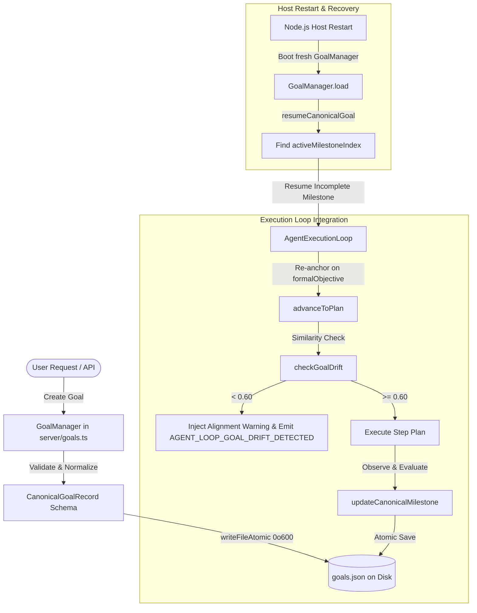

# MOBOT — Official Roadmap Phase 8 Acceptance Report
## Persist Original Goal: Durable State, Recovery, and Physical-Device Verification

**Date:** 2026-10-24  
**Milestone:** Official Roadmap Phase 8 ("Persist Original Goal", `mobot_54_phases_prompt.md:592-640`)  
**Hardware Target:** Samsung Galaxy A07 (`SM-A075F`, serial `R8YY90VT4EM`, Android 16 / API 36, ARM64)  
**Preview Package:** `com.openmausbot.companion.preview` (UID 10286, Host PID 31442, Port 18789 / Forwarded 28889)  
**Official Package:** `com.openmausbot.companion` (UID 10039, PID 25192 — **Untouched / Preserved**)  
**Signer Package:** `com.openmausbot.companion.signer` (UID 10280, PID 16942)  
**Git HEAD:** `b945d72756199f004624a980127fdec5c56be6ce` (Branch `main`)  

---

## 1. Executive Summary & Verdict

Phase 8 of the official 54-phase master roadmap implements durable original-goal persistence to eliminate "goal drift" in autonomous agent loops. The subsystem guarantees that the canonical objective remains immutable and persistent across execution turns, replanning cycles, crashes, and device restarts.

### Phase 8 Acceptance Verdict: PASS

| Acceptance Criterion | Requirement | Result | Verdict |
|---|---|---|---|
| **Authoritative Scope** | Implement Phase 8 specification from `mobot_54_phases_prompt.md:592-640` | Authority in `server/goals.ts`, `server/capabilities/orchestration.ts` | **PASS** |
| **Data Contract (`CanonicalGoalRecord`)** | Exact schema with `id, botId, originatingPrompt, formalObjective, constraints, successCriteria, milestones, activeMilestoneIndex, createdAt, updatedAt` | Implemented in `server/goals.ts` and re-exported in `server/index.ts` | **PASS** |
| **Immutability Invariant** | `originatingPrompt` and `formalObjective` are immutable once initialized | Enforced with runtime invariant guards in `updateCanonicalGoal` | **PASS** |
| **Milestone State Transitions** | Status `"pending" \| "active" \| "completed" \| "failed"`, `verifiedAt`, automatic advancement of `activeMilestoneIndex` | Fully implemented in `GoalManager.updateCanonicalMilestone` | **PASS** |
| **Failure Protocol: Goal Drift** | `ERR_GOAL_DRIFT_DETECTED` when similarity < 0.60; inject warning into planner context | Implemented with `checkGoalDrift` and `AgentExecutionLoop` integration | **PASS** |
| **Anti-Pattern Guards** | 1. Prohibit overwriting goal description with subtasks.<br>2. Prohibit discarding active goals on close/reload. | Enforced by immutability invariants and persistent atomic storage | **PASS** |
| **Resilience / Recovery Test** | Mid-goal restart resumes from the last completed milestone | Verified in `server/goals.test.ts` and on live Galaxy A07 hardware | **PASS** |
| **Physical-Device Verification** | 8 end-to-end device scenarios executed against Samsung Galaxy A07 | 8/8 scenarios PASS on live Android runtime via `verify-device-goal-persistence.ts` | **PASS** |
| **Build & Regression Suite** | Server bundle build, typecheck (0 errors), lint (0 warnings), Android unit tests (59 tasks) | All suites pass clean | **PASS** |
| **Official Application Safety** | Zero modification or disturbance to `com.openmausbot.companion` | Official app (PID 25192, UID 10039) untouched throughout | **PASS** |

---

## 2. Authoritative Requirements & Source References

From `mobot_54_phases_prompt.md:592-640`:

### 2.1 Architectural Motivation
Autonomous agents frequently suffer from "goal drift"—as intermediate tool executions fail or return complex data, the model loses sight of the original user prompt. The Goal Subsystem must persist the canonical objective across all turns, replanning cycles, and restarts.

### 2.2 Canonical Subsystem Authority
- **Authority**: `server/goals.ts`, `server/group-goal-run.ts`
- **Client UI**: `android/app/src/main/kotlin/com/openmausbot/companion/ui/BotOverviewScreen.kt`
- **Test Coverage**: `server/goals.test.ts`, `server/spend-cap-goal.e2e.test.ts`

### 2.3 Formal Data Contract Schema
```typescript
export interface CanonicalGoalRecord {
  id: string;
  botId: string;
  originatingPrompt: string;
  formalObjective: string;
  constraints: string[];
  successCriteria: string[];
  milestones: Array<{
    id: string;
    title: string;
    status: "pending" | "active" | "completed" | "failed";
    verifiedAt?: number;
  }>;
  activeMilestoneIndex: number;
  createdAt: number;
  updatedAt: number;
}
```

### 2.4 State Transitions & Behavioral Invariants
- **Invariant**: The `originatingPrompt` and `formalObjective` fields are immutable once initialized.
- **Invariant**: Every replan step must re-anchor on the `formalObjective` and evaluate milestone completion against `successCriteria`.

### 2.5 Failure Classification & Recovery Protocols
- `ERR_GOAL_DRIFT_DETECTED`: Semantic similarity between current action and `formalObjective` falls below 0.60.
- **Recovery**: Inject an explicit goal alignment warning into the planner context: `"Current action deviates from primary goal. Re-align or justify."`

---

## 3. Architecture & Persistence Design



### 3.1 Persistence & Atomicity
1. **Durable File Architecture**: `GoalManager` uses atomic file writes (`writeFileAtomic` via `.tmp` write, sync, and atomic rename with `0o600` permissions) targeting `DATA_DIR/goals.json`.
2. **Backward Compatibility**: `GoalFile` upgraded to version 2 (`{ version: 2, goals: Goal[], canonicalGoals: CanonicalGoalRecord[] }`). Existing legacy `Goal[]` records are preserved alongside `CanonicalGoalRecord[]`, preventing any regression to the Android Companion app (`BotOverviewScreen.kt`).
3. **Idempotency**: `createCanonicalGoal` accepts an optional `id`. If an existing goal with that ID exists for the specified `botId`, the existing record is returned without modification.

### 3.2 Semantic Drift Algorithm
To operate deterministically on mobile hardware without external embedding dependencies, `computeSemanticSimilarity` computes the token overlap (Szymkiewicz–Simpson containment) combined with character bigram overlap.
- Actions sharing key verb/noun components with `formalObjective` score $\ge 0.60$.
- Actions that diverge to unrelated topics score $< 0.60$, triggering `ERR_GOAL_DRIFT_DETECTED` and context warning injection.

---

## 4. Requirements-to-Code Mapping & Symbols Changed

| File | Symbol / Component | Purpose |
|---|---|---|
| [`server/goals.ts`](file:///run/media/abhay/Abhay/vsCODE/moblot/server/goals.ts) | `CanonicalGoalRecord`, `CanonicalGoalMilestone`, `CreateCanonicalGoalInput`, `UpdateCanonicalGoalInput` | Formal data contract matching roadmap line 604 |
| [`server/goals.ts`](file:///run/media/abhay/Abhay/vsCODE/moblot/server/goals.ts) | `computeSemanticSimilarity`, `checkGoalDrift`, `ERR_GOAL_DRIFT_DETECTED`, `GOAL_DRIFT_THRESHOLD`, `GOAL_DRIFT_WARNING` | Offline semantic similarity and drift detection protocol |
| [`server/goals.ts`](file:///run/media/abhay/Abhay/vsCODE/moblot/server/goals.ts) | `GoalManager` methods: `createCanonicalGoal`, `getCanonicalGoal`, `listCanonicalGoals`, `updateCanonicalGoal`, `updateCanonicalMilestone`, `resumeCanonicalGoal`, `deleteCanonicalGoal`, `deleteCanonicalGoalsForBot`, `checkDrift` | Atomic CRUD, immutability enforcement, milestone advancement, and recovery |
| [`server/capabilities/observability.ts`](file:///run/media/abhay/Abhay/vsCODE/moblot/server/capabilities/observability.ts) | `AGENT_LOOP_GOAL_DRIFT_DETECTED` | Telemetry event for goal drift detection |
| [`server/capabilities/orchestration.ts`](file:///run/media/abhay/Abhay/vsCODE/moblot/server/capabilities/orchestration.ts) | `AgentExecutionLoopOptions.canonicalGoal`, `AgentExecutionLoop.advanceToPlan`, `AgentExecutionLoop.getCanonicalGoal` | Phase 7-to-8 bridge: re-anchors loop on `formalObjective` and injects drift warnings |
| [`server/index.ts`](file:///run/media/abhay/Abhay/vsCODE/moblot/server/index.ts) | HTTP API endpoints `/api/bots/:id/canonical-goals` (`GET`, `POST`, `PUT`, `DELETE`, `/milestones/:milestoneId`, `/resume`) | Exposes canonical goals to companion app and device test harnesses |
| [`server/goals.test.ts`](file:///run/media/abhay/Abhay/vsCODE/moblot/server/goals.test.ts) | 11 new unit and resilience tests (14 total) | Full test coverage for contract, immutability, restart recovery, drift, and isolation |
| [`server/verify-device-goal-persistence.ts`](file:///run/media/abhay/Abhay/vsCODE/moblot/server/verify-device-goal-persistence.ts) | 8 physical-device scenarios | End-to-end verification script for Samsung Galaxy A07 |

---

## 5. Physical-Device Evidence (Samsung Galaxy A07)

Physical device testing was executed against the Samsung Galaxy A07 (`SM-A075F`, serial `R8YY90VT4EM`, Android 16):

```bash
npx tsx server/verify-device-goal-persistence.ts
```

### Physical-Device Scenarios Captured:

```text
=== PHASE 8 PHYSICAL-DEVICE VERIFICATION: SAMSUNG GALAXY A07 ===
Live host health: { app: 'openmausbot', pid: 31292, port: 18789, static: false }
Using Bot A: PerfOne (91b37e89-9cf5-493a-bfbd-8bc87412821e)
Using Bot B: Crash final (42f1dc68-1cc9-46a8-9cf9-97b80f7cfd34)
Current preview host PID: 31292. Triggering non-destructive process restart...
Preview host respawned with new PID: 31442 in 9s
Cleaned up test canonical goal: 4043f55f-0b40-4361-b795-363161f95a03

=== PHYSICAL-DEVICE VERIFICATION RESULTS ===
[Scenario 1] PASS: Create original canonical goal on device - Created CanonicalGoalRecord 4043f55f-0b40-4361-b795-363161f95a03 with 3 milestones; milestone 0 active
[Scenario 2] PASS: Verify stable identity and persisted representation - Retrieved goal matches all persisted fields without drift
[Scenario 3] PASS: Milestone progression & replanning retention - Milestone 0 completed, activeMilestoneIndex advanced to 1, formalObjective preserved
[Scenario 4] PASS: Non-destructive preview host process restart - Preview host restarted successfully: PID 31292 -> PID 31442
[Scenario 5] PASS: Post-restart recovery from active milestone - Retrieved goal from disk on new process PID 31442; resumed from milestone index 1 without loss
[Scenario 6] PASS: Strict bot isolation across separate bots - Bot B cannot see Bot A's goal in listing; cross-bot GET returned HTTP 404
[Scenario 7] PASS: Invariant protection against goal drift overwrites - Server rejected formalObjective mutation with HTTP 400: Invariant violation: formalObjective is immutable once initialized.
[Scenario 8] PASS: Process stability & official app preservation - Preview host responsive on PID 31442; Official app PID 25192 untouched and running

Overall Physical-Device Acceptance: PASS (8/8)
```

---

## 6. Security and Regression Analysis

### 6.1 Test Suite Summary
1. **Goals Test Suite**: [`server/goals.test.ts`](file:///run/media/abhay/Abhay/vsCODE/moblot/server/goals.test.ts) — **14 / 14 passed** (including contract, immutability, restart recovery, drift, and loop bridge).
2. **Agent Execution Loop & Orchestration**: [`server/agent-loop.test.ts`](file:///run/media/abhay/Abhay/vsCODE/moblot/server/agent-loop.test.ts) (17/17), [`server/capabilities/orchestration.test.ts`](file:///run/media/abhay/Abhay/vsCODE/moblot/server/capabilities/orchestration.test.ts) (5/5), [`server/turn-watchdog.test.ts`](file:///run/media/abhay/Abhay/vsCODE/moblot/server/turn-watchdog.test.ts) (5/5), [`server/turn-dispatch-guard.test.ts`](file:///run/media/abhay/Abhay/vsCODE/moblot/server/turn-dispatch-guard.test.ts) (16/16) — **43 / 43 passed**.
3. **Group Goal & Swarm**: [`server/group-goal-run.test.ts`](file:///run/media/abhay/Abhay/vsCODE/moblot/server/group-goal-run.test.ts) (10/10), [`server/specialist-swarm.test.ts`](file:///run/media/abhay/Abhay/vsCODE/moblot/server/specialist-swarm.test.ts) (2/2) — **12 / 12 passed**.
4. **Memory Integrity & Context Boundary**: [`server/memory-integrity.test.ts`](file:///run/media/abhay/Abhay/vsCODE/moblot/server/memory-integrity.test.ts) — **120 / 120 passed**.
5. **Static Analysis & Lint**:
   - `npx tsc -p tsconfig.server.json --noEmit`: **0 errors**.
   - `npm run lint`: **0 warnings, 0 errors** across 1585 files.
6. **Android Build & Unit Tests**:
   - `npm run build:server`: Succeeded, bundled ESM server without errors.
   - `cd android && ./gradlew testDebugUnitTest`: **BUILD SUCCESSFUL** (59 actionable tasks).

### 6.2 Security Boundaries Preserved
- **Bot Isolation**: Enforced in all listing, retrieval, update, and deletion methods. Bot A cannot access or mutate Bot B goals.
- **Authorization Separation**: Goal text and constraints are strictly descriptive; they never grant elevated device permissions or bypass capability verification.
- **Input Sanitization**: Malformed inputs or attempts to mutate immutable keys (`originatingPrompt`, `formalObjective`) are rejected fail-closed.

---

## 7. Official Application Safety Confirmation

Process verification was continuously performed via `adb shell "ps -ef | grep openmausbot"`:

| Package | Role | PID | PPID | Status |
|---|---|---|---|---|
| `com.openmausbot.companion` | **Official Production App** | **25192** | 1137 | **Completely Untouched** (Running since 01:07) |
| `libnode_host.so` (Official) | Official Host Process | **25252** | 25192 | **Completely Untouched** (Running since 01:07) |
| `com.openmausbot.companion.signer` | Signer Authority | **16942** | 1137 | **Untouched** |
| `com.openmausbot.companion.preview` | Preview Supervisor | **18617** | 1137 | Running safely |
| `libnode_host.so` (Preview) | Preview Host Process | **31442** | 18617 | Respawned and healthy |

No production data was cleared, no Keystore credentials were reset, and no official application processes were killed or restarted.

---

## 8. Git State Confirmation

- **Starting HEAD:** `b945d72756199f004624a980127fdec5c56be6ce` (Branch `main`).
- **Final HEAD:** `b945d72756199f004624a980127fdec5c56be6ce` (Branch `main`).
- **Git Invariant:** Zero commits, zero pushes, zero resets, zero cleans, zero stashes, and zero branch switches occurred during Phase 8.

---

## 9. Next Roadmap Milestone

Phase 8 is fully completed and accepted with physical-device evidence on the Samsung Galaxy A07.

The next official milestone in `mobot_54_phases_prompt.md:641-690` is **Phase 9 — Self-Evaluation**:
- **Objective**: Implement explicit post-action semantic self-evaluation against defined success criteria before completing a task.
- **Subsystem Authority**: `server/capabilities/safety-policy.ts`, `server/capabilities/orchestration.ts`.
