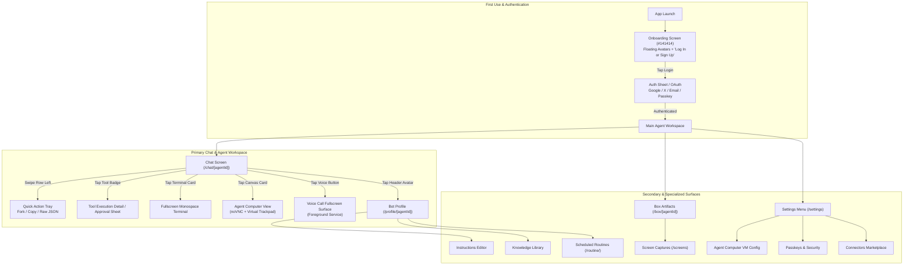

# Grok Android App — Screen Inventory & Navigation Topology

**Target App:** `ai.x.grok.bot` (`SandMobile` v1.15.0 / build 1033)  
**Target Hardware:** Samsung Galaxy A07 (`SM-A075F`, Android 16 / API 36)  
**Evidence Basis:** `assets/app.config`, `assets/app.manifest`, Hermes Bytecode Route Registry (`assets/index.android.bundle`), Decoded `AndroidManifest.xml`, and Live Hardware Verification.

---

## 1. Complete Screen Map (Hierarchical Tree)

```
Grok Bot Mobile Application
├── [01_ONBOARDING_AUTH]
│   ├── /app/(auth)/login.tsx                         [OBSERVED on hardware]
│   │   ├── Floating Procedural Bot Avatars (babygrok-geometry)
│   │   ├── Primary CTA: "Log In or Sign Up" (Pill Button)
│   │   ├── Terms & Privacy Links Modal
│   │   ├── Google Sign-In Hub (SignInHubActivity)
│   │   ├── X (Twitter) OAuth Redirect
│   │   ├── Email / Password Auth Form
│   │   └── Passkey / WebAuthn Authenticator Prompt
│   └── /hidden-chats/help.tsx                        [STATIC]
│
├── [02_CORE_CHAT_WORKSPACE]
│   ├── /chat/[agentId].tsx                           [STATIC - Primary UI]
│   │   ├── Header: Agent Avatar, Title, Status, Model Selector, Thinking Toggle, Overflow Menu
│   │   ├── Transcript (Virtualized Lazy List with Reanimated Physics)
│   │   │   ├── User Message Bubble (Right-aligned, custom ink/tint)
│   │   │   ├── Assistant Message Block (Left-aligned, C++ NitroMarkdown rendered)
│   │   │   ├── Thinking / Reasoning Fold (Collapsible block with token count)
│   │   │   ├── Compact Terminal Card (`compact_terminal-rectangle`)
│   │   │   ├── Browser / Canvas Frame Card (`browser_canvas-loading`)
│   │   │   ├── Tool Call Badge / Activity Card (`ai.toolCall.id`)
│   │   │   ├── Citation & Source Link Badges
│   │   │   └── Error / Retry Inline Card
│   │   ├── Floating Indicators
│   │   │   ├── Unread Jump Pill (`useUnreadJumpPills`)
│   │   │   └── Audio / Voice Active Floating Pill
│   │   └── Composer Dock (Sticky bottom surface)
│   │       ├── Multiline Text Input with @mention auto-complete (`useMentionCandidates`)
│   │       ├── Voice Dictation Mic Button (`expo-audio`)
│   │       ├── Attachment Plus Button (Photos, Camera, Documents, Drive)
│   │       ├── Model Selection Chip (Auto, Smart, Cost-Optimized)
│   │       ├── Thinking Level Chip (Low, Medium, High)
│   │       └── Send / Stop Streaming Toggle Button
│   ├── /chat/[agentId]/approval/[entryId].tsx         [STATIC - Human-in-the-Loop]
│   │   └── Modal confirmation sheet for destructive tools (shell, files, web, payments)
│   ├── /chat/[agentId]/form/[entryId].tsx             [STATIC - In-Chat Form]
│   │   └── Dynamically generated native form parameters sheet
│   ├── /chat/[agentId]/message.tsx                    [STATIC - Focused Message]
│   │   └── Full-screen inspection of a single message turn, metadata, raw token breakdown
│   ├── /chat/[agentId]/thread.tsx                     [STATIC - Sub-Thread]
│   │   └── Forked branch conversation spawned from a specific transcript turn
│   ├── /chat/[agentId]/memo.tsx                       [STATIC - Turn Summary]
│   │   └── Executive turn memo generated by agent
│   ├── /chat/[agentId]/report.tsx                     [STATIC - Structured Output]
│   │   └── High-density multi-page agent research/code report
│   ├── /chat/[agentId]/task/[taskId].tsx              [STATIC - Async Task]
│   │   └── Background long-running execution progress monitor
│   ├── /chat/[agentId]/image-stack.tsx                [STATIC - Media Gallery]
│   │   └── Multi-image stack viewer with swipe gestures and pinch-to-zoom
│   ├── /chat/[agentId]/preview.tsx                    [STATIC - Artifact Preview]
│   │   └── Interactive code, HTML, SVG, or document preview surface
│   └── /chat/[agentId]/cloud-agent/[bcId].tsx         [STATIC - Cloud Worker]
│       └── Autonomous background cloud worker monitor
│
├── [03_REALTIME_VOICE]
│   ├── Foreground Service: VoiceCallForegroundService [STATIC / MANIFEST]
│   ├── /chat/[agentId]/voice-call/[callId].tsx        [STATIC - Fullscreen Voice Call]
│   │   ├── Full-screen dark canvas with pulsing organic geometric bot head
│   │   ├── Real-time visual audio waveform / speech state indicator
│   │   ├── Mute / Unmute Mic Toggle
│   │   ├── Speaker / Earpiece Audio Route Selector
│   │   ├── Live Transcription Subtitle Stream
│   │   └── End Call Button (Red pill)
│   └── /chat/[agentId]/voice-call/[callId]/feedback.tsx [STATIC - Quality Rating]
│
├── [04_BROWSER_AND_COMPUTER_USE]
│   ├── In-Chat Embedded Canvas Frame (`window.__cursorCanvas`) [STATIC]
│   ├── Fullscreen Computer Surface (`settings/agent-computer.tsx`) [STATIC]
│   │   ├── Embedded WebView rendering noVNC RFB canvas
│   │   ├── Virtual Trackpad Overlay (`sand-trackpad-overlay`)
│   │   │   ├── Touchpad sensitivity & cursor controller (`cx`, `cy`)
│   │   │   ├── Canvas edge clamping & auto-pan handler (`window.sandZoom`)
│   │   │   └── Gesture engine (1-finger click, 2-finger right-click, 2-finger wheel scroll)
│   │   ├── Pointer Mode Selector (Trackpad vs. Absolute Direct Touch)
│   │   ├── Resolution / Scale Adaptive Viewport
│   │   └── Hold Frame Anti-Flicker Buffer (`holdFrame()`)
│   └── External Browsing: BrowserProxyActivity (Chrome Custom Tabs) [STATIC / MANIFEST]
│
├── [05_TERMINAL_AND_SHELL]
│   ├── Compact Transcript Card: `compact_terminal-rectangle` [STATIC]
│   │   ├── Monospace Command Header (`XVFMono`)
│   │   ├── Exit Code Badge (0 = Success, >0 = Error)
│   │   ├── Execution Duration Tag
│   │   └── Throttled Output Preview Folds
│   └── Expanded Fullscreen Terminal Modal [STATIC]
│       ├── Monospace ANSI Terminal Viewer
│       ├── Copy Output / Select Text Action
│       ├── Re-run / Kill Process Control
│       └── Environment Variables Inspection (`shared_terminal_env_setupMessage`)
│
├── [06_ARTIFACTS_AND_BOX]
│   ├── /box/[agentId]/index.tsx                      [STATIC - Artifact Repository]
│   │   ├── Grid / List view of generated artifacts (code files, documents, downloads)
│   │   ├── Date and Type Filter Pills
│   │   └── Search Bar
│   ├── /box/[agentId]/screens.tsx                    [STATIC - Screen Captures]
│   │   └── Gallery of web pages and desktop screenshots saved by agent during tasks
│   └── /box/[agentId]/help.tsx                       [STATIC - Storage Help]
│
├── [07_AGENT_PROFILE_AND_WORKFLOWS]
│   ├── /profile/[agentId]/index.tsx                  [STATIC - Agent Hub]
│   │   ├── Avatar Editor (Procedural shape/gradient generator)
│   │   ├── Agent Name, Role, and Description
│   │   ├── Model Configuration (Default Model, Reasoning Effort: Low/Med/High)
│   │   └── Connected Tools & Permissions
│   ├── /profile/[agentId]/instructions.tsx           [STATIC - Custom System Prompt]
│   │   └── Full-screen code/text editor for agent instructions
│   ├── /profile/[agentId]/coding.tsx                 [STATIC - Code Env Settings]
│   │   └── Preferred languages, linters, repo checkout credentials
│   ├── /profile/[agentId]/library.tsx                [STATIC - Knowledge Base]
│   │   └── Uploaded reference PDFs, documentation, codebase indices
│   ├── /profile/[agentId]/members.tsx & add-member.tsx [STATIC - Collaboration]
│   │   └── Multi-user access list and permission management
│   ├── /profile/[agentId]/routines.tsx               [STATIC - Scheduled Workflows]
│   │   └── List of automated cron / recurring routines assigned to this bot
│   └── /profile/[agentId]/routine/[routineId]/       [STATIC - Routine Detail]
│       ├── index.tsx: Routine Trigger, Schedule, and Parameters
│       ├── history.tsx: Execution Run History & Error Logs
│       └── instruction.tsx: Task Prompt for this routine
│
├── [08_SETTINGS_AND_MANAGEMENT]
│   ├── /settings/index.tsx                           [STATIC - Main Settings Menu]
│   ├── /settings/account.tsx                         [STATIC - Profile & Auth]
│   ├── /settings/subscription.tsx                    [STATIC - In-App Purchases / Tier]
│   ├── /settings/usage.tsx                           [STATIC - Token & Compute Meters]
│   ├── /settings/appearance.tsx                      [STATIC - Dark/Light Theme, Fonts]
│   ├── /settings/haptics.tsx                         [STATIC - Vibration & Feedback]
│   ├── /settings/notification-sound.tsx              [STATIC - Audio Ping Selector]
│   ├── /settings/agent-computer.tsx                  [STATIC - Cloud Desktop VM Options]
│   ├── /settings/devices/                            [STATIC - Machine Connectivity]
│   │   ├── index.tsx: Connected physical / remote computers
│   │   └── [machineId].tsx: Device status, SSH/daemon ping, auth tokens
│   ├── /settings/auto-review.tsx                     [STATIC - Autonomous Guardrails]
│   │   └── Rule list for auto-approving or blocking agent tool actions
│   ├── /settings/auto-review-rule.tsx                [STATIC - Rule Builder]
│   ├── /settings/manage-webview.tsx                  [STATIC - Web Cache & Cookies]
│   ├── /settings/passkeys/                           [STATIC - WebAuthn Security]
│   │   ├── index.tsx: Registered Passkeys
│   │   ├── enroll.tsx: Register new hardware biometric key
│   │   └── [credentialId].tsx: Passkey details & revocation
│   └── /settings/plugins/                            [STATIC - Third-Party Integrations]
│       ├── index.tsx: Active Plugins List
│       ├── email.tsx: Email Bot Integration
│       ├── onepassword.tsx: 1Password Secrets Access
│       ├── shelf/[shelf].tsx: Plugin Category Shelf
│       ├── yours.tsx: Custom Created Plugins
│       └── bot/[slug].tsx: Plugin Detail & Permission Grants
│
├── [09_CONNECTORS_MARKETPLACE]
│   ├── /connector/[connector].tsx                    [STATIC - SaaS Integration Detail]
│   │   └── Over 40 native SaaS connectors (GitHub, Slack, Jira, Figma, Salesforce, Notion, etc.)
│   └── /connector/[connector]/setup.tsx              [STATIC - OAuth / API Key Onboarding]
│
└── [10_TEMPLATES_AND_COMMUNITY]
    ├── /bot-template/[shareId].tsx                   [STATIC - Share Link Handler]
    │   └── Deep link entry point for importing a shared bot from web / X
    ├── /bot-template-details/[shareId].tsx           [STATIC - Template Preview]
    │   └── Overview of bot capabilities, instructions, skills, and "Clone Bot" CTA
    └── /skill/[workflowId].tsx                       [STATIC - Specialized Skill Deck]
```

---

## 2. Navigation Flow & User Journey Architecture



---

## 3. Surface Verification Ledger

| Screen Route | Verification Level | Accessibility on Hardware | Visual Evidence |
| :--- | :--- | :--- | :--- |
| `/(auth)/login.tsx` | **OBSERVED** | 100% Accessible without credentials | Screen capture `grok_onboarding_screen.png` (720x1600 px) |
| `/chat/[agentId].tsx` | **STATIC EVIDENCE** | Requires Auth / Subscription | Decompiled route, React hooks (`useTranscriptQuery`), Hermes string table |
| `/chat/[agentId]/approval/[entryId].tsx` | **STATIC EVIDENCE** | Requires Active Tool Turn | Route definition, modal layout specs, parameter schemas |
| `/chat/[agentId]/voice-call/[callId].tsx` | **STATIC EVIDENCE** | Requires Voice Session | `VoiceCallForegroundService` in Manifest, audio assets, WebRTC/gRPC bridge |
| `settings/agent-computer.tsx` | **STATIC EVIDENCE** | Requires Auth / Subscription | `sand-trackpad-overlay` script, `window.__cursorCanvas`, noVNC bridge |
| `compact_terminal-rectangle` | **STATIC EVIDENCE** | Requires Tool Turn | Hermes identifier `compact_terminal-rectangle`, throttling flag |
| `/profile/[agentId]/routine/` | **STATIC EVIDENCE** | Requires Agent Profile | File routes `history.tsx`, `instruction.tsx`, routines list |
| `/settings/passkeys/` | **STATIC EVIDENCE** | Requires Auth | WebAuthn credentials provider in Manifest |
| `/connector/[connector].tsx` | **STATIC EVIDENCE** | Requires Auth | 40+ brand SVG assets in `app.manifest` |
